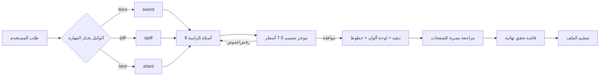

<div align="center">


<br>

**ثلاث مهارات (Agent Skills) لـ [OpenCode](https://opencode.ai) تُحوّل مخرجات الوكيل من «ملف منسّق» إلى «مستند احترافي».**

[](LICENSE)
[](https://opencode.ai/docs/skills/)
[](#-المهارات-الثلاث)
[](#-دعم-العربية-rtl)
[](#-معيار-واحد-ثلاثة-وكلاء)
[](#-معيار-واحد-ثلاثة-وكلاء)
[](#-الاستخدام)

**العربية** · **[English](README.md)**

`sword` · `spdf` · `shtml`

</div>

---

## 📌 الفكرة في سطر واحد

معظم الملفات التي يولّدها الوكلاء «صحيحة» لكنها **قبيحة**: نص أسود 11pt، جداول Word الافتراضية، عربية بخط مكسور، صفحات بلا هوية. هذه المهارات الثلاث تُلزم الوكيل بمنهجية تصميم كاملة قبل أن يكتب سطراً واحداً.

| | بدون هذه المهارات | مع هذه المهارات |
|---|---|---|
| **الشكل** | تنسيق افتراضي، جدول `Table Grid` | غلاف بلون الهوية، أنماط Heading، جداول بلا حدود عمودية |
| **العربية** | خط افتراضي ومقلوبة الاتجاه | `w:cs` + `w:rtl` + `bidiVisual` صحيحة |
| **العناصر** | فقرات نص فقط | بطاقات KPI، صناديق تنبيه، خطوط زمنية، رسوم SVG |
| **الأسئلة** | يبدأ فوراً ويخمّن | **يسأل 9 أسئلة إلزامية أولاً** ثم يعرض موجز تصميم للموافقة |
| **التسليم** | ملف يُفتح ويُترك | مراجعة بصرية للصفحات + قائمة تحقق نهائية |

---

## 🧩 المهارات الثلاث

### 🗡️ `sword` — Word (`.docx`)

مستندات Word قابلة للتعديل بمستوى بصري احترافي عبر `python-docx`.

- غلاف بهوية بصرية بلا ترويسة ولا ترقيم
- أنماط `Heading` مخصّصة قابلة لتعديلها من لوحة Styles في Word
- ترويسة وتذييل احترافيان بحقلي `PAGE` و`NUMPAGES`
- جداول أنيقة: رأس ملوّن، صفوف متبادلة، رأس متكرر، صف إجمالي بارز
- صناديق Callout بخلفية فاتحة وحدّ جانبي ملوّن
- عربية RTL كاملة على مستوى المستند والفقرة والنص

### 📄 `spdf` — PDF نهائي للطباعة

ملفات PDF بجودة مطبعة عبر `WeasyPrint` أو Chromium.

- هندسة صفحات دقيقة عبر `@page` كامل
- رؤوس وتذييلات جارية: «صفحة X من Y»
- **فهرس بأرقام صفحات حقيقية** عبر `target-counter`
- رسوم SVG مضمنة بألوان الهوية مع تسميات ومصادر
- خطوط عربية مضمّنة محلياً (`@font-face`)
- تحقق إلزامي بـ `pdffonts` و`pdftoppm` قبل التسليم

### 🌐 `shtml` — HTML متجاوب ومستقل

صفحات وتقارير HTML حديثة **بملف واحد بلا أي اعتماديات**.

- نظام توكنات CSS كامل (`:root`)
- وضع ليلي تلقائي عبر `prefers-color-scheme`
- بطاقات KPI + جداول + خط زمني + SVG مضمن
- استجابة مؤكدة على 375 / 768 / 1440px
- `@media print` جاهز للتحويل إلى PDF
- إتاحة: تباين ≥ 4.5:1، `:focus-visible`، HTML دلالي

---

## 🧩 معيار واحد، ثلاثة وكلاء

المهارات مبنية على [معيار Agent Skills المفتوح](https://agentskills.io/specification) — نفس ملف `SKILL.md` يعمل بلا تعديل في OpenCode وClaude Code وCodex. الفرق الوحيد هو مسار التثبيت:

| الوكيل | مسار المشروع | مسار المستخدم | الاستدعاء |
|---|---|---|---|
| **OpenCode** | `.opencode/skills/` | `~/.config/opencode/skills/` | تلقائي، أو `use skill sword` |
| **Claude Code** | `.claude/skills/` | `~/.claude/skills/` | `/sword` |
| **Codex CLI** | `.agents/skills/` | `~/.agents/skills/` | `$sword` أو `/skills` |

وهذه المسارات يقرأها أيضاً Cursor وGitHub Copilot CLI وGemini CLI وAntigravity — فتثبيت واحد يخدم أكثر من وكيل.

### ملاحظات خاصة بكل منصة

- **Claude Code** — الملف يحمل `allowed-tools: Read, Write, Edit, Bash, Glob, Grep`، فيستطيع تشغيل Python وWeasyPrint وLibreOffice دون طلب إذن لكل أداة. الاستدعاء بـ `/sword`، ويعمل أيضاً تلقائياً من الـ description.
- **Codex CLI** — يقرأ `name` و`description` فقط (و`metadata.short-description` للعرض) ويتجاهل الباقي. **أعد تشغيل Codex** بعد التثبيت ثم استخدم `/skills` أو `$sword`. *النسخ الأقدم كانت تقرأ `~/.codex/skills/` — إن لم يُكتشف `.agents/skills/` فثبّت بـ `--codex-legacy`.*
- **OpenCode** — يقرأ `.opencode/skills/` أصلاً، وكذلك `.claude/skills/` و`.agents/skills/` كمسارات توافق، فتثبيت واحد يكفي للثلاثة.

### التثبيت حسب الوكيل

```bash
./install.sh --all --global                  # كل الوكلاء، نطاق المستخدم
./install.sh --claude --global               # Claude Code فقط   → ~/.claude/skills/
./install.sh --codex  --global               # Codex فقط         → ~/.agents/skills/
./install.sh --opencode --project ~/my-app   # OpenCode في مشروع واحد
./install.sh --list                          # عرض المهارات
```

**تعمل داخل المستودع بوكيل برمجة؟** ملف `AGENTS.md` في الجذر يحمل القواعد الدائمة — المصدر الأصلي، عدم تعديل النسخ المولّدة، وعدم إضعاف بروتوكول الأسئلة — فيتصرف أي وكيل يفتح المستودع بشكل صحيح دون أن تشرح له.

**مصدر واحد للحقيقة:** `.opencode/skills/` هو الأصل، و`.claude/skills/` و`.agents/skills/` نسخ مولّدة آلياً. عدّل الأصل ثم شغّل:

```bash
./scripts/sync-platforms.sh          # إعادة التوليد
./scripts/sync-platforms.sh --check  # تحقق من عدم وجود انحراف (مناسب لـ CI)
```

---

## 🚀 التثبيت

### الطريقة 1 — سكربت التثبيت (موصى بها)

```bash
git clone https://github.com/abduallahJamal/opencode-design-skills.git
cd opencode-design-skills

# تثبيت عام لكل المشاريع  ←  ~/.config/opencode/skills/
./install.sh --global

# أو تثبيت في مشروع محدد  ←  ./.opencode/skills/
./install.sh --project /path/to/your-project
```

### الطريقة 2 — نسخ يدوي

```bash
# مستوى المشروع
mkdir -p .opencode/skills
cp -r opencode-design-skills/.opencode/skills/* .opencode/skills/

# أو المستوى العام (كل مشاريعك)
mkdir -p ~/.config/opencode/skills
cp -r opencode-design-skills/.opencode/skills/* ~/.config/opencode/skills/
```

### الطريقة 3 — Git Submodule

```bash
git submodule add https://github.com/abduallahJamal/opencode-design-skills.git .opencode/vendor/design-skills
ln -s ../vendor/design-skills/.opencode/skills/sword .opencode/skills/sword
```

> **تحقّق من التثبيت:** افتح OpenCode ونفّذ `أي مهارات متاحة لديك؟` — يجب أن تظهر `sword` و`spdf` و`shtml` في قائمة `available_skills`.
> التفاصيل الكاملة في [دليل استكشاف الأخطاء](#-استكشاف-الأخطاء).

---

## 🗂️ مواقع الاكتشاف الرسمية

OpenCode يبحث عن المهارات في ستة مواقع، واسم المجلد **يجب أن يطابق** حقل `name`:

| النطاق | المسار |
|---|---|
| مشروع (OpenCode) | `.opencode/skills/<name>/SKILL.md` |
| عام (OpenCode) | `~/.config/opencode/skills/<name>/SKILL.md` |
| مشروع (Claude-compatible) | `.claude/skills/<name>/SKILL.md` |
| عام (Claude-compatible) | `~/.claude/skills/<name>/SKILL.md` |
| مشروع (Agent-compatible) | `.agents/skills/<name>/SKILL.md` |
| عام (Agent-compatible) | `~/.agents/skills/<name>/SKILL.md` |

قواعد صارمة يفرضها OpenCode على `name`: حروف صغيرة وأرقام وشرطات مفردة فقط، بحد أقصى 64 حرفاً، ومطابقة تامة لاسم المجلد — أي `^[a-z0-9]+(-[a-z0-9]+)*$`.

---

## 🧠 كيف تعمل المهارة في الواقع



### بروتوكول «اسأل أولاً» — إلزامي

كل مهارة تحتوي على **قاعدة ذهبية**: يُمنع كتابة سطر واحد من الكود قبل إجابات كافية.

1. اطرح الحزمة الأولى (4–5 أسئلة) دفعةً واحدة — لا إغراق.
2. أكمل المتبقي في دفعة ثانية عند الضرورة.
3. لخّص الإجابات في **موجز تصميم** واطلب موافقة صريحة.
4. نفّذ، ثم **راجع الصفحات بصرياً** قبل التسليم.

إن رفض المستخدم الإجابة، تُلزمه المهارة بحزمة افتراضية معلنة (Corporate / RTL / A4) تُعتمد بكلمة واحدة — لا تنفيذ صامت.

<details>
<summary><b>الأسئلة التسعة الإلزامية (اضغط للعرض)</b></summary>

| # | السؤال | لماذا هو جوهري |
|---|---|---|
| 1 | ما الهدف من المستند؟ (تقرير، عرض سعر، كتيب، وثيقة تقنية، بروفايل… ) | يحدد الهيكل بالكامل |
| 2 | من الجمهور المستهدف؟ | يحدد مستوى الرسمية والكثافة |
| 3 | ستايل معين؟ (Minimal، Corporate، Modern Dark، ملون قوي، فاخر) | يحدد اللوحة والخطوط |
| 4 | الألوان المفضلة أو هوية العلامة؟ | يمنع التخمين اللوني |
| 5 | شعار أو صور مضافة؟ | يحدد الغلاف والترويسة |
| 6 | الحجم التقريبي أو عدد الصفحات؟ | يحدد كثافة المحتوى |
| 7 | جداول أو رسوم بيانية أو إنفوجرافيك؟ | يحدد العناصر البصرية |
| 8 | محتوى جاهز أم أكتبه من الصفر؟ | يحدد مسؤولية المحتوى |
| 9 | تفاصيل إضافية؟ (اللغة، RTL، الترويسة، السرية، الحماية) | يحدد المتطلبات الخاصة |

</details>

---

## 🎨 نظام التصميم المشترك

المهارات الثلاث تتشارك لغة تصميم واحدة، فتبدو مخرجاتك متسقة أياً كان الملف.

### اللوحات اللونية

| اللوحة | Ink | Accent | Accent2 | Surface |
|---|---|---|---|---|
| **Corporate Blue** | `#0F172A` | `#1D4ED8` | `#0EA5A4` | `#F8FAFC` |
| **Modern Dark** | `#0B1220` | `#38BDF8` | `#A78BFA` | `#111827` |
| **Luxury** | `#1C1917` | `#B08D57` | `#7C2D12` | `#FAF7F2` |
| **Government** | `#111827` | `#0F766E` | `#9A3412` | `#F9FAFB` |
| **Vibrant** | `#0F172A` | `#7C3AED` | `#F59E0B` | `#FAF5FF` |

### سلّم الخطوط

| الاستخدام | عربي | لاتيني | الحجم |
|---|---|---|---|
| عنوان الغلاف | Cairo / Tajawal / Amiri | Inter / Playfair | 34–48pt · 700–800 |
| H1 | Cairo / Dubai | Inter | 22–26pt · 700 |
| H2 | Cairo | Inter | 15–17pt · 600 |
| نص | IBM Plex Sans Arabic | Inter | 10–11.5pt · 400 · `line-height: 1.85` |
| تسمية | Cairo | Inter | 8–9pt · Muted |

### المبادئ الثمانية

1. **هرمية بصرية صريحة** — فرق محسوس بين كل مستوى.
2. **شبكة ومسافات مدروسة** — 4/8px كوحدة أساس، مساحة بيضاء 25–35%.
3. **لون واحد قوي + محايدات** — لا «قوس قزح».
4. **كل عنصر يحمل معنى** — لا زخرفة بلا وظيفة.
5. **الاتساق قبل الإبداع** — نفس الغلاف والجداول في كل صفحة.
6. **قابلية التعديل** — أنماط حقيقية لا تنسيق يدوي.
7. **Bidi نظيف** — العربية أولاً، والأرقام تُعرض صحيحة.
8. **الطباعة أولاً** — لا عناصر مقطوعة ولا صفحات يتيمة.

---

## 🇸🇦 دعم العربية (RTL)

هذا هو الفرق الأكبر بين «ملف فيه عربي» و«ملف عربي احترافي». كل مهارة تتعامل مع الفخاخ الحقيقية:

| الفخ | الحل المطبَّق في المهارات |
|---|---|
| العربية تظهر بخط افتراضي قبيح في Word | ضبط `w:rFonts` على `ascii` + `hAnsi` + **`cs`** مع `w:szCs` |
| علامات الترقيم في الجهة الخطأ | `w:bidi` على مستوى المستند والفقرة والنمط |
| الجداول تبدأ من العمود الخطأ | `w:bidiVisual` على الجدول |
| الحروف تتفكك | منع `letter-spacing` الموجب على العربية |
| الخطوط تختفي عند المستلم | تضمين الخطوط محلياً + التحقق عبر `pdffonts` |
| الأرقام تختلط بالنص | خلايا رقمية بـ `direction: ltr` منفصلة |
| `justify` يُنتج فراغات قبيحة | محاذاة `start` مع `text-align-last` |

---

## 🧪 الاستخدام

بعد التثبيت، اطلب من OpenCode بشكل طبيعي — سيختار المهارة تلقائياً من `description`:

```text
اكتب لي تقرير أداء سنوي 2026 لشركة في قطاع الطاقة، عربي، 8 صفحات،
ستايل Corporate أزرق داكن، فيه بطاقات مؤشرات وجدول مالي ورسم بياني،
وسلّمه PDF.

اعمل عرض سعر لخدمات استشارية بصيغة Word قابلة للتعديل، بشعار الشركة
الموجود في ./assets/logo.png، وترويسة فيها اسم الجهة ورقم الصفحة.

حوّل هذا المحتوى إلى صفحة HTML احترافية متجاوبة مع وضع ليلي.
```

📖 المزيد من المطالبات الجاهزة للنسخ: **[docs/usage-examples.md](docs/usage-examples.md)**

**استدعاء صريح** (لتجاوز الاختيار التلقائي):

```text
use skill sword
/sword            # إن فعّلت metadata.opencode/slash
```

> المهارات مصمّمة لتسألك أولاً. توقّع 4–5 أسئلة قبل أي ملف — هذا سلوك مقصود، وليس تعطيلاً.

---

## 📁 هيكل المستودع

```text
opencode-design-skills/
├── .opencode/skills/             # ← المصدر الأصلي
│   ├── sword/SKILL.md            # Word / .docx
│   ├── spdf/SKILL.md             # PDF
│   └── shtml/SKILL.md            # HTML
├── .claude/skills/               # مولّد → Claude Code
├── .agents/skills/               # مولّد → Codex / Cursor / Gemini
├── .github/
│   └── workflows/validate.yml    # CI: frontmatter + انحراف النسخ + الروابط
├── assets/
│   └── banner.svg
├── docs/
│   ├── usage-examples.md         # أمثلة مطالبات جاهزة (عربي)
│   ├── usage-examples.en.md      # أمثلة مطالبات جاهزة (English)
├── install.sh                    # سكربت تثبيت
├── AGENTS.md                     # سياق دائم لوكلاء البرمجة
├── scripts/
│   ├── sync-platforms.sh         # توليد .claude/ و.agents/
│   └── publish.sh                # رفع المستودع إلى GitHub
├── CHANGELOG.md
├── CONTRIBUTING.md
├── LICENSE
├── README.md                     # English
└── README.ar.md                  # العربية (هذا الملف)
```

---

## 🔧 استكشاف الأخطاء

<details>
<summary><b>المهارة لا تظهر في القائمة</b></summary>

1. `SKILL.md` يجب أن تكون **بحروف كبيرة** بالكامل.
2. يجب أن يكون `name` في الـ frontmatter **مطابقاً تماماً** لاسم المجلد.
3. يجب أن يحتوي الـ frontmatter على `name` و`description` معاً.
4. تحقّق من صلاحيات `opencode.json` — المهارات بـ `deny` تُخفى:

```json
{
  "permission": {
    "skill": { "*": "allow", "sword": "allow", "spdf": "allow", "shtml": "allow" }
  }
}
```

5. تحقّق من `metadata["opencode/autoinvoke"]` — إن كانت `"false"` تُخفى من الإرشاد التلقائي (لكن تبقى قابلة للاستدعاء بالاسم).
6. أعد تشغيل OpenCode بعد إضافة ملفات جديدة.

</details>

<details>
<summary><b>الملف يخرج بلا تنسيق — تجاهل التعليمات</b></summary>

الوكيل قد يختصر عند ضيق سياق النموذج. اطلب صراحة:
`use skill sword and follow its checklist fully — ask me the 9 questions first`.

</details>

<details>
<summary><b>Codex لا يرى المهارات</b></summary>

1. يجب أن تكون في `.agents/skills/` (مشروع) أو `~/.agents/skills/` (مستخدم) — **وليس** `.codex/skills/`، وهذا هو الخطأ الأكثر شيوعاً.
2. أعد تشغيل Codex: تُقرأ الميتاداتا مرة واحدة عند بدء الجلسة.
3. نفّذ `/skills` لعرض المكتشف، ثم استدعِ بـ `$sword`.
4. على نسخة قديمة استخدم `./install.sh --codex-legacy --global` لتعبئة `~/.codex/skills/` أيضاً.

</details>

<details>
<summary><b>المتطلبات التشغيلية لكل مهارة</b></summary>

| المهارة | المتطلبات |
|---|---|
| `sword` | `pip install python-docx pillow` · اختياري: LibreOffice للتحقق |
| `spdf` | `pip install weasyprint pypdf pillow` · `poppler-utils` (`pdftoppm`, `pdfinfo`, `pdffonts`) |
| `shtml` | لا شيء — ملف HTML واحد مستقل |

</details>

---

## 🤝 المساهمة

المساهمات مرحّب بها. قبل إرسال PR:

1. حافظ على **بروتوكول «اسأل أولاً»** — لا تحذفه ولا تختصره.
2. أضف أي قاعدة جديدة في القسم المناسب، وليس كملاحظة سائبة.
3. حدّث **قائمة التحقق النهائية** إن أضفت متطلباً.
4. اختبر المهارة فعلياً بولّد ملف واحد على الأقل.
5. راجع [CONTRIBUTING.md](CONTRIBUTING.md) للتنسيق والاصطلاحات.

---

## 🗺️ خارطة الطريق

- [x] `sword` — Word / `.docx`
- [x] `spdf` — PDF
- [x] `shtml` — HTML
- [ ] `sdecks` — عروض PowerPoint (`.pptx`)
- [ ] `sxls` — تقارير Excel (`.xlsx`) بلوحات بيانات
- [ ] `sbrand` — توليد دليل هوية بصرية قابل لإعادة الاستخدام
- [ ] حزمة أمثلة: 12 مستنداً جاهزاً بملفات المصدر

---

## 📜 الترخيص

[MIT](LICENSE) — استخدم، عدّل، وانشر بحرية مع الإشارة للمصدر.

**لغات التوثيق:** [English](README.md) · العربية

---

<div dir="ltr">

## English Summary

**opencode-design-skills** is a set of three [OpenCode](https://opencode.ai/docs/skills/) Agent Skills that push generated documents from *technically correct* to *visually professional* — `sword` (Word `.docx`), `spdf` (print-ready PDF), and `shtml` (self-contained responsive HTML).

All three share one design system (5 palettes, type scale, 8 principles) and one non-negotiable rule: the agent must ask 9 clarifying questions and get sign-off on a design brief **before** writing any code, then perform a visual review and pass a final checklist before delivery.

📖 **[Read the full English documentation →](README.md)**

</div>

---

<div align="center">

**صُنع بعناية لمن يكتبون بالعربية ويصرّون على أن يبدو عملهم احترافياً.**

<sub>إذا أفادتك هذه المهارات، امنح المستودع ⭐</sub>

</div>
