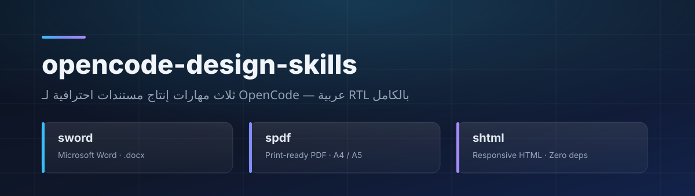
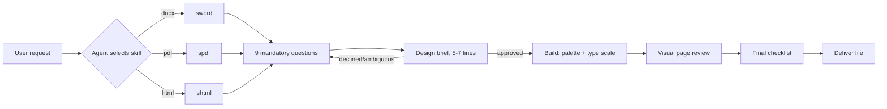

<div align="center">



<br>

**Three [OpenCode](https://opencode.ai) Agent Skills that move agent output from *formatted file* to *professional document*.**

[](LICENSE)
[](https://opencode.ai/docs/skills/)
[](#-the-three-skills)
[](#-arabic-rtl-support)
[

**🌐 English** · **[العربية](README.ar.md)**

</div>

---

## 📌 The idea in one line

Most files agents generate are *technically correct* and *visually ugly*: 11pt black text, Word's default `Table Grid`, broken Arabic shaping, pages with no identity. These three skills force the agent through a complete design methodology **before** it writes a single line of code.

| | Without these skills | With these skills |
|---|---|---|
| **Appearance** | Default formatting, `Table Grid` tables | Branded cover, defined heading styles, borderless tables |
| **Arabic** | Wrong font, broken direction | Correct `w:cs` + `w:rtl` + `bidiVisual` |
| **Visuals** | Paragraphs only | KPI cards, callout boxes, timelines, inline SVG |
| **Questions** | Starts immediately and guesses | **Asks 9 mandatory questions first**, then gets sign-off on a design brief |
| **Delivery** | File opened and abandoned | Visual page-by-page review + final delivery checklist |

---

## 🧩 The three skills

### 🗡️ `sword` — Word (`.docx`)

Editable Word documents at a professional visual level, built with `python-docx`.

- Branded cover page with no header or page number
- Custom `Heading` styles that stay editable in Word's Styles pane
- Professional header/footer with live `PAGE` and `NUMPAGES` fields
- Elegant tables: colored header, zebra rows, repeating header row, prominent total row
- Callout boxes with a tinted fill and an accent side border
- Full Arabic RTL across document, paragraph, and run levels

### 📄 `spdf` — Print-ready PDF

Press-quality PDFs via `WeasyPrint` or headless Chromium.

- Precise page geometry through full `@page` control
- Running headers and footers: "Page X of Y"
- **Table of contents with real page numbers** via `target-counter`
- Embedded SVG charts in brand colors, with numbered captions and sources
- Locally embedded Arabic fonts (`@font-face`) — never a CDN
- Mandatory verification with `pdffonts` and `pdftoppm` before delivery

### 🌐 `shtml` — Responsive, self-contained HTML

Modern HTML pages and reports as **a single file with zero dependencies**.

- Complete CSS design-token system (`:root`)
- Automatic dark mode via `prefers-color-scheme`
- KPI cards, elegant tables, timelines, inline SVG
- Verified responsiveness at 375 / 768 / 1440px
- `@media print` ready for PDF conversion
- Accessibility: ≥ 4.5:1 contrast, `:focus-visible`, semantic HTML

---

## 🚀 Installation

### Option 1 — Install script (recommended)

```bash
git clone https://github.com/YOUR_USERNAME/opencode-design-skills.git
cd opencode-design-skills

# Global: available in every project  →  ~/.config/opencode/skills/
./install.sh --global

# Or project-scoped  →  ./.opencode/skills/
./install.sh --project /path/to/your-project
```

### Option 2 — Manual copy

```bash
# Project scope
mkdir -p .opencode/skills
cp -r opencode-design-skills/.opencode/skills/* .opencode/skills/

# Global scope (all your projects)
mkdir -p ~/.config/opencode/skills
cp -r opencode-design-skills/.opencode/skills/* ~/.config/opencode/skills/
```

### Option 3 — Git submodule

```bash
git submodule add https://github.com/YOUR_USERNAME/opencode-design-skills.git .opencode/vendor/design-skills
ln -s ../vendor/design-skills/.opencode/skills/sword .opencode/skills/sword
```

> **Verify:** open OpenCode and ask `which skills are available?` — `sword`, `spdf`, and `shtml` should appear in the `available_skills` list. See [Troubleshooting](#-troubleshooting).

---

## 🗂️ Official discovery locations

OpenCode searches six locations, and the **folder name must match** the `name` field:

| Scope | Path |
|---|---|
| Project (OpenCode) | `.opencode/skills/<name>/SKILL.md` |
| Global (OpenCode) | `~/.config/opencode/skills/<name>/SKILL.md` |
| Project (Claude-compatible) | `.claude/skills/<name>/SKILL.md` |
| Global (Claude-compatible) | `~/.claude/skills/<name>/SKILL.md` |
| Project (Agent-compatible) | `.agents/skills/<name>/SKILL.md` |
| Global (Agent-compatible) | `~/.agents/skills/<name>/SKILL.md` |

OpenCode enforces strict `name` rules: lowercase alphanumerics with single hyphens, 64 characters max, and an exact match with the containing folder — `^[a-z0-9]+(-[a-z0-9]+)*$`.

---

## 🧠 How a skill actually behaves



### The "ask first" protocol — non-negotiable

Every skill carries a **golden rule**: no code may be written before sufficient answers are collected.

1. Ask the first batch (4–5 questions) in one go — never overwhelm.
2. Follow up with a second batch only if something essential is missing.
3. Summarize answers into a **design brief** and require explicit sign-off.
4. Build, then **review the pages visually** before delivery.

If the user declines to answer, the skill requires declaring an explicit default bundle (Corporate / RTL / A4) approved with a single word — never a silent assumption.

<details>
<summary><b>The 9 mandatory questions (click to expand)</b></summary>

| # | Question | Why it is essential |
|---|---|---|
| 1 | What is the document for? (report, quotation, brochure, technical doc, profile…) | Determines the entire structure |
| 2 | Who is the target audience? | Sets formality and information density |
| 3 | Any specific style? (Minimal, Corporate, Modern Dark, Vibrant, Luxury) | Determines palette and typography |
| 4 | Preferred colors or brand identity? | Eliminates color guessing |
| 5 | Any logo or images to include? | Determines cover and header treatment |
| 6 | Approximate size or page count? | Determines content density |
| 7 | Tables, charts, or infographics? | Determines visual components |
| 8 | Existing content, or should I write it from scratch? | Defines content ownership |
| 9 | Anything else? (language, RTL, header, confidentiality, protection) | Captures special requirements |

</details>

---

## 🎨 Shared design system

All three skills share one design language, so output stays consistent no matter the format.

### Color palettes

| Palette | Ink | Accent | Accent2 | Surface |
|---|---|---|---|---|
| **Corporate Blue** | `#0F172A` | `#1D4ED8` | `#0EA5A4` | `#F8FAFC` |
| **Modern Dark** | `#0B1220` | `#38BDF8` | `#A78BFA` | `#111827` |
| **Luxury** | `#1C1917` | `#B08D57` | `#7C2D12` | `#FAF7F2` |
| **Government** | `#111827` | `#0F766E` | `#9A3412` | `#F9FAFB` |
| **Vibrant** | `#0F172A` | `#7C3AED` | `#F59E0B` | `#FAF5FF` |

### Type scale

| Role | Arabic | Latin | Size |
|---|---|---|---|
| Cover title | Cairo / Tajawal / Amiri | Inter / Playfair | 34–48pt · 700–800 |
| H1 | Cairo / Dubai | Inter | 22–26pt · 700 |
| H2 | Cairo | Inter | 15–17pt · 600 |
| Body | IBM Plex Sans Arabic | Inter | 10–11.5pt · 400 · `line-height: 1.85` |
| Caption | Cairo | Inter | 8–9pt · Muted |

### The 8 principles

1. **Explicit visual hierarchy** — a felt difference at every level.
2. **Grid and deliberate spacing** — 4/8px base unit, 25–35% whitespace.
3. **One strong color plus neutrals** — never a rainbow.
4. **Every element carries meaning** — no decoration without function.
5. **Consistency before creativity** — same cover, same table pattern throughout.
6. **Editability** — real styles, never ad-hoc manual formatting.
7. **Clean bidi** — Arabic first, numbers still render correctly.
8. **Print-first** — no split elements, no orphaned headings.

---

## 🇸🇦 Arabic (RTL) support

This is the biggest gap between "a file containing Arabic" and "a professional Arabic document". Each skill handles the real traps:

| Trap | Handling in the skills |
|---|---|
| Arabic renders in an ugly fallback font in Word | Set `w:rFonts` on `ascii` + `hAnsi` + **`cs`** with `w:szCs` |
| Punctuation lands on the wrong side | `w:bidi` at document, paragraph, and style level |
| Tables start from the wrong column | `w:bidiVisual` on the table |
| Letters fall apart | No positive `letter-spacing` on Arabic |
| Fonts vanish on the recipient's machine | Locally embedded fonts + `pdffonts` verification |
| Numbers mix into Arabic text | Dedicated numeric cells with `direction: ltr` |
| `justify` produces ugly gaps | `text-align: start` with `text-align-last` |

---

## 🧪 Usage

Once installed, just ask OpenCode normally — it selects the skill automatically from the `description`:

```text
Write a 2026 annual performance report for an energy company: English,
8 pages, Corporate dark-blue style, with KPI cards, a financial table
and a revenue chart. Deliver as PDF.

Draft a consulting services quotation as an editable Word file with the
company logo at ./assets/logo.png, a header showing the company name,
and page numbering.

Turn this content into a professional, responsive HTML page with dark mode.
```

📖 More copy-paste prompts: **[docs/usage-examples.en.md](docs/usage-examples.en.md)**

**Explicit invocation** (bypasses auto-selection):

```text
use skill sword
/sword            # if metadata.opencode/slash is enabled
```

> These skills are designed to question you first. Expect 4–5 questions before any file is produced — that is intentional behavior, not a stall.

---

## 📁 Repository structure

```text
opencode-design-skills/
├── .opencode/
│   └── skills/
│       ├── sword/
│       │   └── SKILL.md          # Word / .docx
│       ├── spdf/
│       │   └── SKILL.md          # PDF
│       └── shtml/
│           └── SKILL.md          # HTML
├── assets/
│   └── banner.svg
├── docs/
│   ├── usage-examples.en.md      # ready-to-use prompts (English)
│   └── usage-examples.md         # ready-to-use prompts (Arabic)
├── install.sh                    # installer
├── scripts/
│   └── publish.sh                # push to GitHub
├── CHANGELOG.md
├── CONTRIBUTING.md
├── LICENSE
├── README.md                     # English (this file)
└── README.ar.md                  # العربية
```

---

## 🔧 Troubleshooting

<details>
<summary><b>A skill does not appear in the list</b></summary>

1. `SKILL.md` must be spelled in **all caps**.
2. The frontmatter `name` must **exactly match** the containing folder name.
3. The frontmatter must contain both `name` and `description`.
4. Check your `opencode.json` permissions — skills set to `deny` are hidden:

```json
{
  "permission": {
    "skill": { "*": "allow", "sword": "allow", "spdf": "allow", "shtml": "allow" }
  }
}
```

5. Check `metadata["opencode/autoinvoke"]` — when `"false"`, the skill is hidden from model-facing guidance (it stays loadable by exact name).
6. Restart OpenCode after adding new files.

</details>

<details>
<summary><b>Output comes out unstyled — instructions were ignored</b></summary>

The agent may shortcut under tight model context. Ask explicitly:
`use skill sword and follow its checklist fully — ask me the 9 questions first`.

</details>

<details>
<summary><b>Runtime requirements per skill</b></summary>

| Skill | Requirements |
|---|---|
| `sword` | `pip install python-docx pillow` · optional: LibreOffice for verification |
| `spdf` | `pip install weasyprint pypdf pillow` · `poppler-utils` (`pdftoppm`, `pdfinfo`, `pdffonts`) |
| `shtml` | None — a single self-contained HTML file |

</details>

---

## 🤝 Contributing

Contributions are welcome. Before opening a PR:

1. Preserve the **"ask first" protocol** — never delete or shorten it.
2. Add any new rule in its proper section, not as a loose footnote.
3. Update the **final delivery checklist** if you add a requirement.
4. Actually test it by generating at least one real file.
5. See [CONTRIBUTING.md](CONTRIBUTING.md) for conventions.

---

## 🗺️ Roadmap

- [x] `sword` — Word / `.docx`
- [x] `spdf` — PDF
- [x] `shtml` — HTML
- [ ] `sdecks` — PowerPoint decks (`.pptx`)
- [ ] `sxls` — Excel reports (`.xlsx`) with dashboards
- [ ] `sbrand` — reusable brand-guideline generator
- [ ] Sample pack: 12 ready-made documents with source files

---

## 📜 License

[MIT](LICENSE) — use, modify, and distribute freely with attribution.

**Documentation languages:** [English](README.md) · [العربية](README.ar.md)

**Docs:** [Usage examples (EN)](docs/usage-examples.en.md) · [أمثلة الاستخدام (AR)](docs/usage-examples.md)

---

<div align="center">

**Built for people who write in Arabic — and insist their work look professional.**

<sub>If these skills help you, give the repo a ⭐</sub>

</div>
